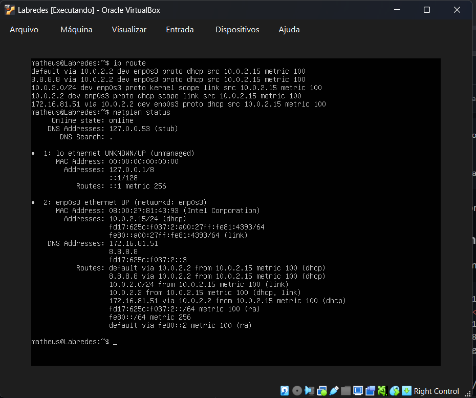
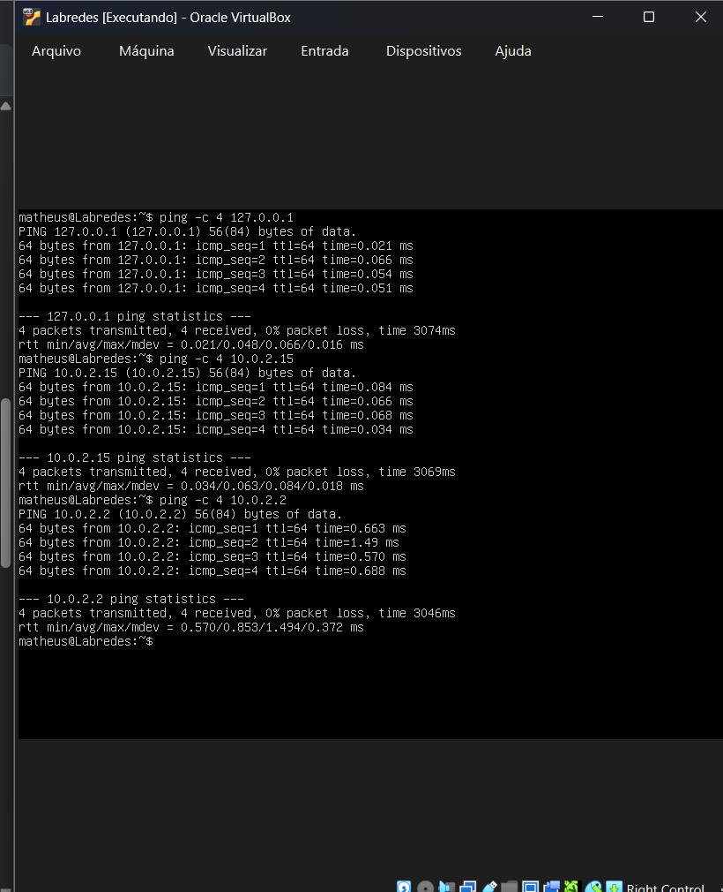
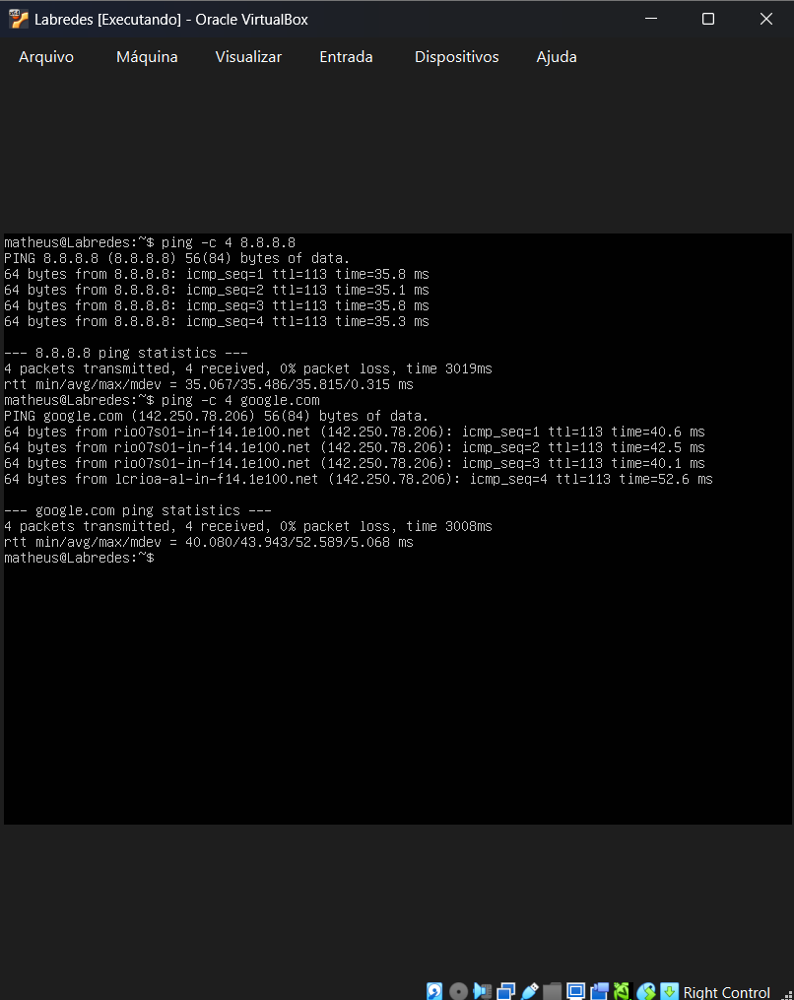

# Laboratório de Redes: Endereçamento IP e Conectividade

## 🎯 Objetivo
Estudar o endereçamento IP e utilizar comandos de diagnóstico de redes no Linux para validar interfaces, rotas, resolução DNS e conectividade.

---

## 🛠️ Procedimento e Evidências

### 1. Identificação de Interfaces, Endereços e Rotas
Para levantar as configurações de rede da máquina virtual, foram executados os comandos `ip addr show`, `ip link`, `ip route` e `netplan status`:

* **`ip addr show` e `ip link`:** Utilizados para listar as interfaces de rede disponíveis, verificar o estado operacional (`UP`) e obter o endereço físico (MAC) e os endereços lógicos (IPv4 e IPv6).
* **`ip route`:** Consultado para exibir a tabela de roteamento do kernel e identificar o **Gateway Padrão** (`10.0.2.2`), responsável por encaminhar pacotes para fora da sub-rede local.
* **`netplan status`:** Empregado para consolidar em uma única saída o status da conexão, os endereços IP atribuídos via DHCP, os servidores DNS configurados e as rotas ativas.

---

### 2. Testes de Conectividade Interna e Gateway
Para validar o funcionamento da pilha TCP/IP em camadas, executou-se o comando `ping -c 4` (enviando 4 pacotes ICMP) para os endereços locais:

* **`127.0.0.1` (Loopback):** Confirmou que a pilha de rede interna do sistema operacional está ativa e respondendo.
* **`10.0.2.15` (IP da VM):** Validou que a interface `enp0s3` está devidamente configurada e operacional.
* **`10.0.2.2` (Gateway Padrão):** Comprovou a comunicação entre a máquina virtual e o roteador virtual NAT do VirtualBox.

---

### 3. Testes de Conectividade Externa e Resolução DNS
Por fim, verificou-se o acesso à internet e o funcionamento do serviço de nomes:

* **`8.8.8.8`:** O disparo de pacotes diretamente para o servidor DNS público do Google comprovou que o tráfego está atravessando o gateway NAT e alcançando a rede externa.
* **`google.com`:** A resposta positiva a partir de um nome de domínio confirmou que a resolução DNS está traduzindo endereços corretamente (`142.250.78.206`).

---

## 📝 Questões e Respostas

### Pergunta 1 — Identificação dos parâmetros de rede da VM
Os parâmetros abaixo foram extraídos diretamente das saídas dos comandos `netplan status` e `ip route`:

| Parâmetro | Valor Identificado | Como foi obtido |
| :--- | :--- | :--- |
| **Nome da Interface** | `enp0s3` | Listada como interface Ethernet ativa (`UP`) em `ip link`, `ip addr show` e `netplan status`. |
| **IP/Prefixo (IPv4)** | `10.0.2.15/24` | Atribuído via DHCP e exibido na seção *Addresses* do `netplan status` (e campo `inet` do `ip addr show`). |
| **Endereço IPv6** | `fd17:625c:f037:2:a00:27ff:fe81:4393/64` | Exibido na seção *Addresses* do `netplan status` (e campo `inet6` do `ip addr show`). |
| **Endereço MAC** | `08:00:27:81:43:93` | Identificado no campo *MAC Address* do `netplan status` (e campo `link/ether` do `ip link`). |
| **Gateway Padrão** | `10.0.2.2` | Obtido pela rota padrão (`default via 10.0.2.2`) nos comandos `ip route` e `netplan status`. |

---

### Pergunta 2 — Por que o host não alcança o IP `10.0.2.15` no modo NAT?
O endereço `10.0.2.15` existe apenas dentro de uma rede virtual privada emulada pelo motor NAT do VirtualBox. O sistema operacional do *Host* não possui uma interface de rede configurada nessa sub-rede nem uma rota direcionada para ela, tornando esse IP inacessível diretamente a partir da máquina física sem a configuração de redirecionamento de portas (*Port Forwarding*).

---

### Pergunta 3 — Análise da execução do comando `ping`
Todos os testes foram concluídos com **0% de perda de pacotes** (4 pacotes transmitidos e 4 recebidos em cada etapa). Isso comprova que:
1. A interface local e o protocolo TCP/IP estão íntegros (`127.0.0.1` e `10.0.2.15`);
2. Há comunicação estável com o gateway virtual (`10.0.2.2`);
3. O roteamento externo (`8.8.8.8`) e a resolução de nomes DNS (`google.com`) funcionam sem falhas.

---

### Pergunta 4 — Diferença funcional entre NAT e Bridge
* **Modo NAT:** A VM opera em uma sub-rede privada e isolada (`10.0.2.15/24`), acessando a rede externa por meio de um gateway virtual (`10.0.2.2`) que traduz os endereços usando o IP do *Host*. Isso permite que a VM navegue na internet, mas bloqueia conexões iniciadas diretamente do *Host* (ou de outros dispositivos da rede local) para a VM sem regras de redirecionamento de portas.
* **Modo Bridge (Placa em Ponte):** A interface virtual da VM conecta-se diretamente à rede física do *Host*, recebendo um endereço IP na mesma faixa do roteador local (via DHCP da rede física). Isso garante comunicação bidirecional direta entre o *Host*, a VM e os demais dispositivos da rede local.
