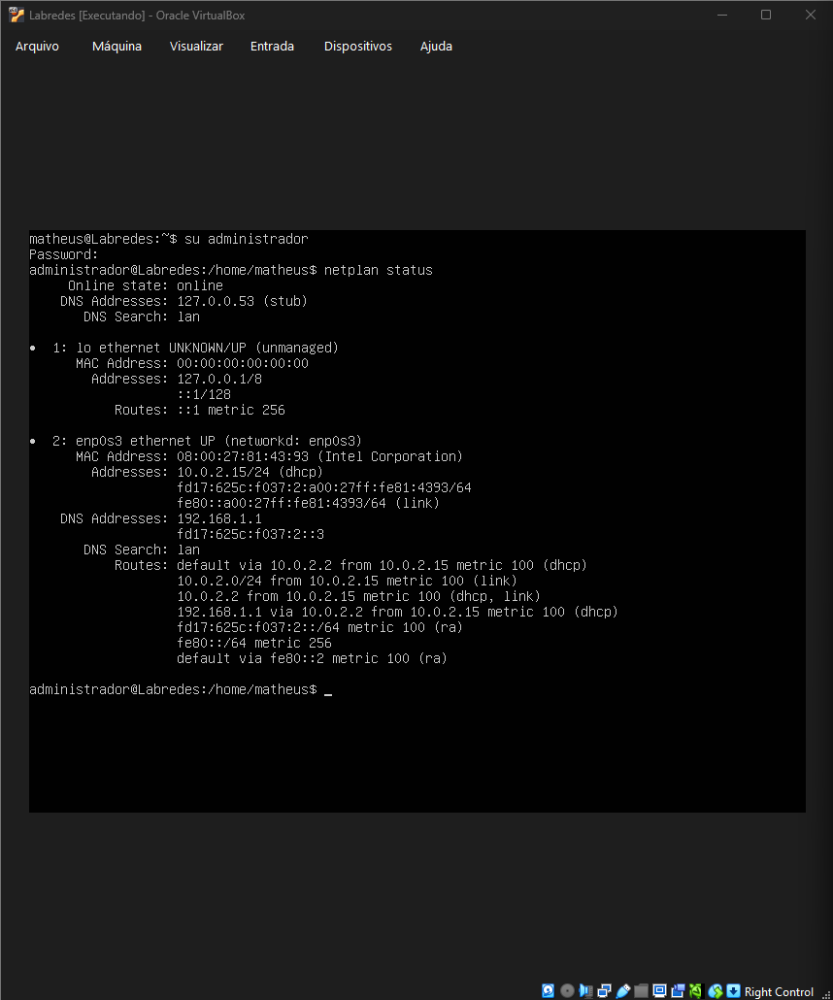
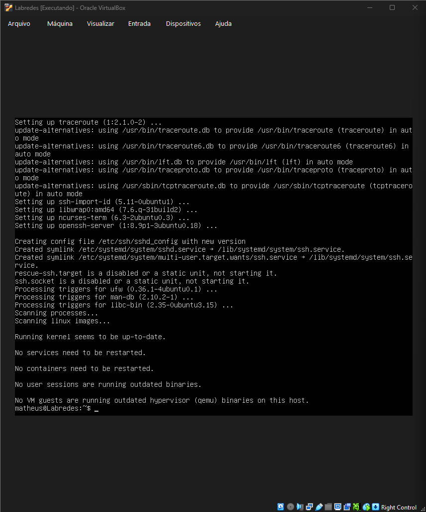
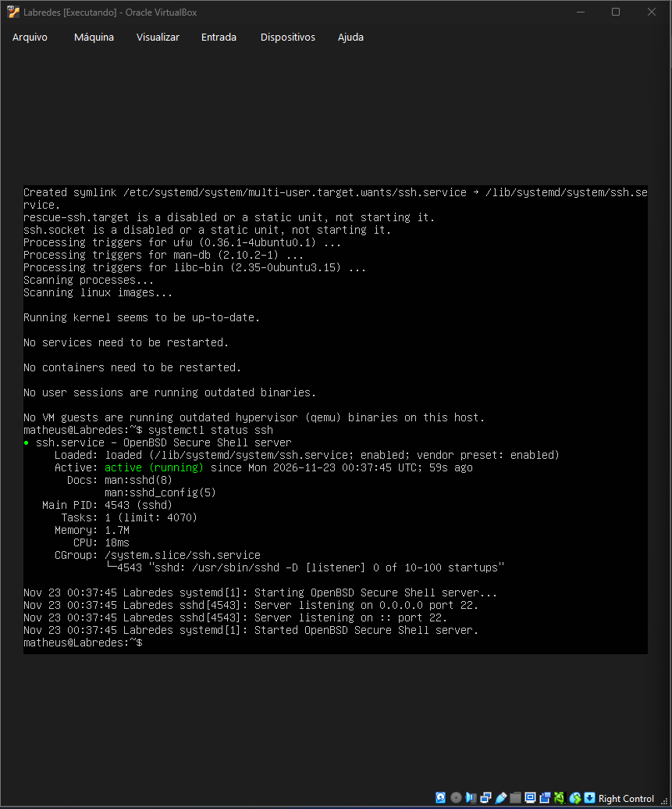
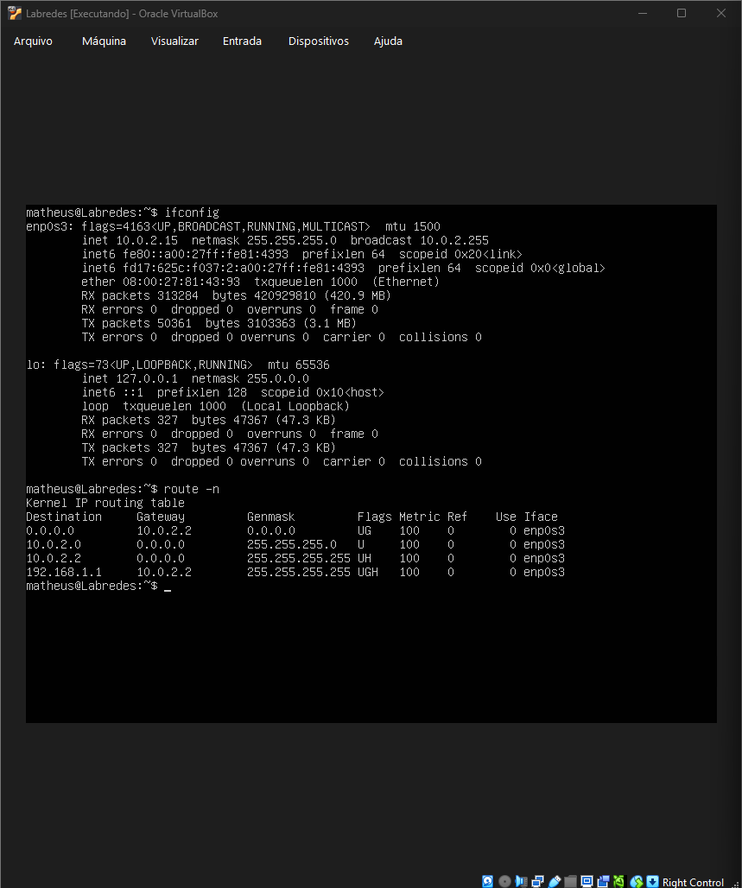
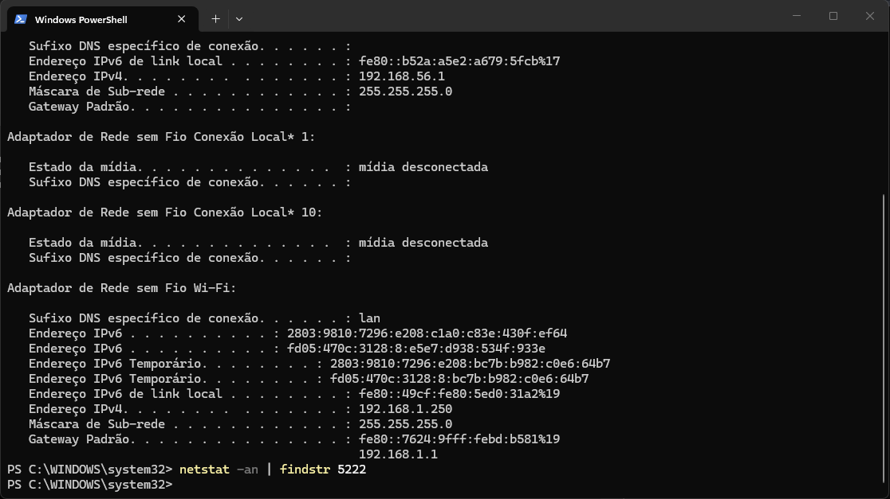
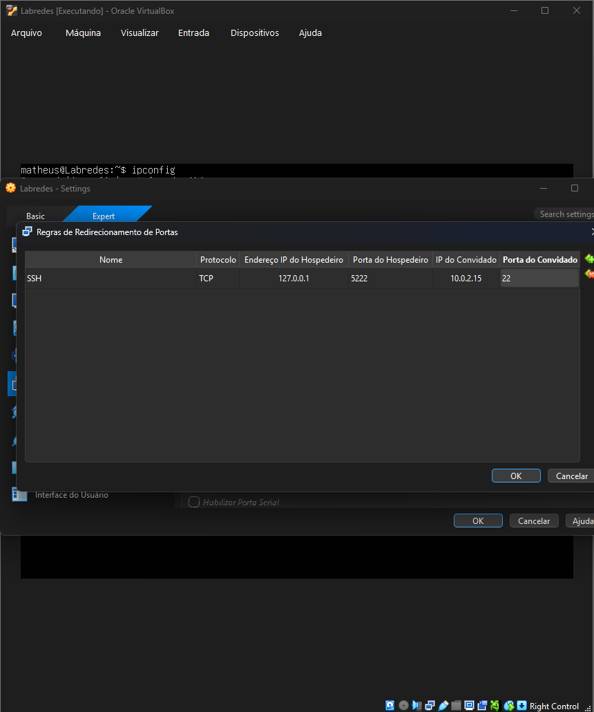
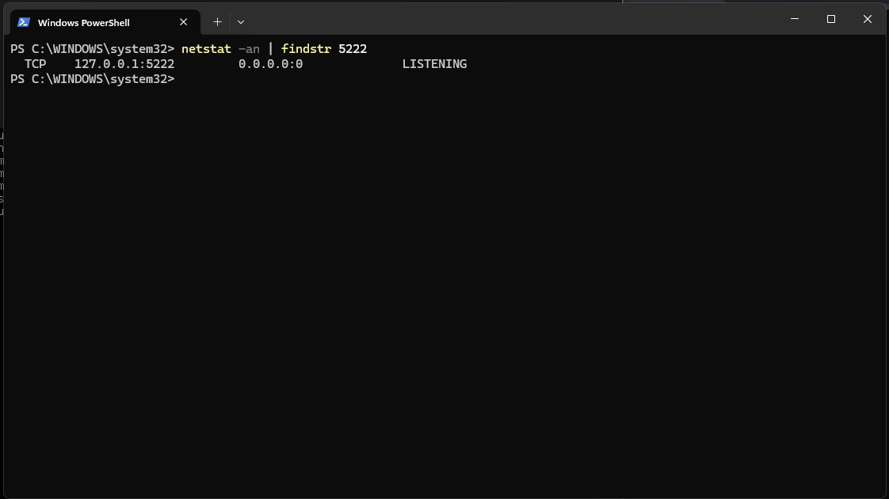
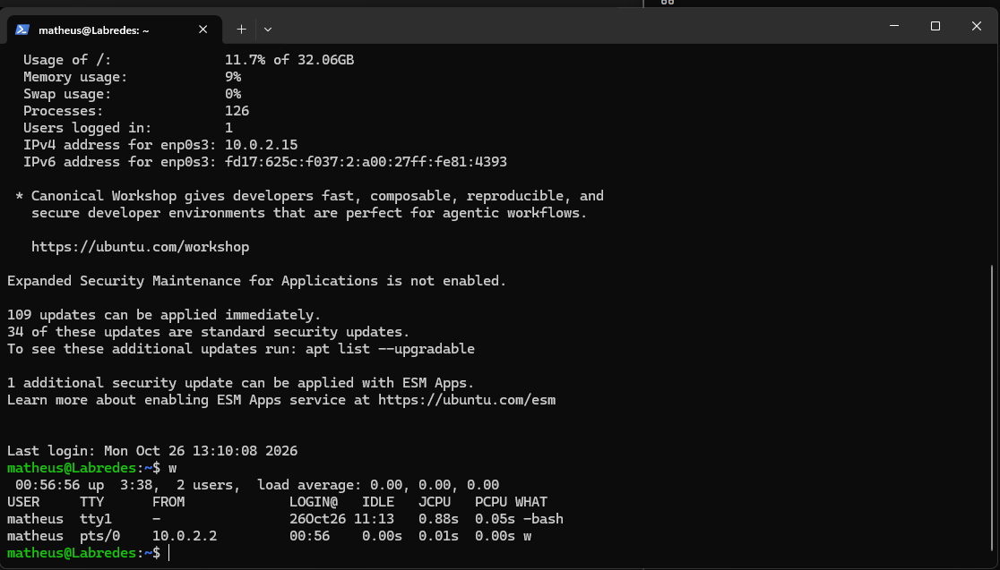
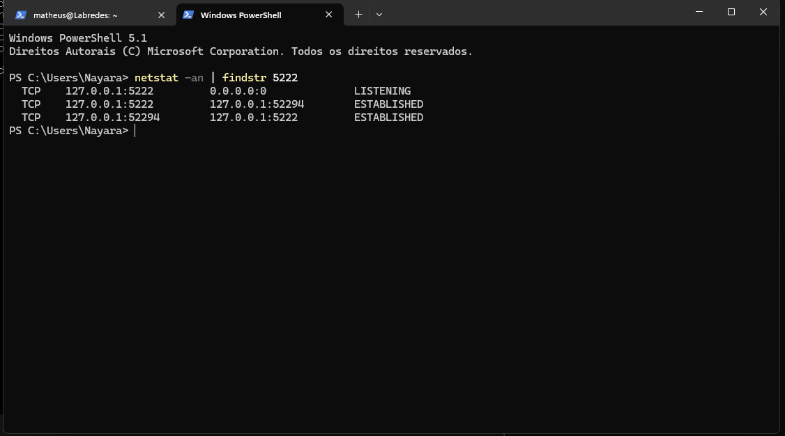

# Relatório Prático: Diagnóstico de Rotas, Controle de Portas com Netstat e Acesso Remoto SSH em Ambiente NAT

## 1. 👤 Identificação

* **Nome Completo:** Matheus Santos Bezerra
* **Matrícula:** 2024332233
* **Turma:** Técnico em Desenvolvimento de Sistemas 2026.02
* **Data:** 22/11/2026
* **Título da Prática:** Diagnóstico de Rotas, Controle de Portas com `netstat` e Acesso Remoto SSH em Ambiente NAT

---

## 2. 🎯 Objetivo

Realizar o diagnóstico completo de rede (endereçamento IP, máscara de sub-rede, endereço MAC e tabela de roteamento) entre um host Windows e uma máquina virtual **Ubuntu Server 26.04 LTS**, configurar o redirecionamento de portas (*Port Forwarding*) em rede **NAT** no Oracle VirtualBox (`5222 -> 22`), auditar o ciclo de vida dos sockets TCP (`vazio`, `LISTENING` e `ESTABLISHED`) por meio do utilitário `netstat` e validar o acesso administrativo remoto via **SSH**, identificando o pseudoterminal (`pts/0`) atribuído à sessão.

---

## 3. 🖥️ Ambiente

O laboratório foi executado em ambiente virtualizado no **Oracle VirtualBox**, interligando o sistema hospedeiro (Windows) à máquina virtual convidada (`Labredes`) por meio de uma interface virtual configurada em modo **NAT**:

| Componente | Sistema Operacional / Software | Interface / Modo de Rede | Endereço IP / Máscara | Gateway / Porta | Endereço MAC |
| :--- | :--- | :--- | :--- | :--- | :--- |
| **Host (Hospedeiro)** | Windows (PowerShell 5.1)[cite: 11] | Adaptador Wi-Fi / Loopback[cite: 10, 15] | `192.168.1.250` / `255.255.255.0` (Wi-Fi)[cite: 15] `127.0.0.1` (Loopback)[cite: 10] | Gateway: `192.168.1.1`[cite: 15] Porta Host: `5222/TCP`[cite: 16] | — |
| **Rede VirtualBox** | Oracle VirtualBox (NAT)[cite: 16] | VirtualBox Host-Only[cite: 15] | `192.168.56.1` / `255.255.255.0`[cite: 15] | Redirecionamento: `127.0.0.1:5222 -> 10.0.2.15:22`[cite: 16] | — |
| **VM (Convidado)** | Ubuntu Server 26.04 LTS (`Labredes`)[cite: 12] | `enp0s3` (Modo NAT)[cite: 12, 16] | `10.0.2.15/24` (`255.255.255.0`)[cite: 12, 13] | Gateway: `10.0.2.2`[cite: 12, 13] Porta SSH: `22/TCP`[cite: 16, 17] | `08:00:27:81:43:93`[cite: 12, 13] |

---

## 4. ⚙️ Procedimento

As etapas abaixo foram executadas em ordem cronológica para preparar, configurar e auditar o ambiente:

1. **Verificação inicial da rede na VM:** Autenticação como `administrador` e execução de `netplan status` para confirmar o estado online da interface `enp0s3`, o IP obtido via DHCP e a rota padrão[cite: 13].
2. **Instalação dos utilitários e do servidor SSH:** Instalação dos pacotes `net-tools`, `traceroute` e `openssh-server` via gerenciador `apt` para habilitar ferramentas clássicas de diagnóstico e o daemon `sshd`[cite: 14].
3. **Verificação do serviço SSH:** Execução de `systemctl status ssh` para confirmar que o servidor OpenSSH está habilitado na inicialização e escutando conexões na porta `22`[cite: 17].
4. **Diagnóstico de interfaces e rotas no Linux:** Execução de `ifconfig` e `route -n` na VM para inspecionar IP, máscara, MAC e a tabela de roteamento do kernel[cite: 12].
5. **Diagnóstico de rede e auditoria prévia no Windows:** Execução de `ipconfig` e `netstat -an | findstr 5222` no PowerShell para identificar os parâmetros do host e comprovar que a porta `5222` ainda não estava aberta (retorno vazio)[cite: 15].
6. **Configuração do redirecionamento NAT no VirtualBox:** Criação da regra `SSH` (`TCP`, `127.0.0.1:5222` para `10.0.2.15:22`) nas configurações de rede da VM[cite: 16].
7. **Auditoria do estado `LISTENING` no Windows:** Nova execução de `netstat -an | findstr 5222` para validar que o VirtualBox passou a escutar a porta `5222` no endereço de loopback[cite: 10].
8. **Acesso remoto via SSH e validação final:** Conexão a partir do Windows com `ssh -p 5222 matheus@127.0.0.1`[cite: 18], execução do comando `w` dentro da VM para identificar o terminal `pts/0`[cite: 18] e nova verificação com `netstat -an | findstr 5222` no Windows confirmando o estado `ESTABLISHED`[cite: 11].

---

## 5. 🧪 Testes e Evidências

### 5.1. Verificação Inicial da Pilha de Rede da VM (`netplan status`)

* **Como foi obtido:** Após alternar para o usuário `administrador` (`su administrador`), executou-se `netplan status`[cite: 13]. O comando consulta o gerenciador de rede do Ubuntu e exibe o estado `Online state: online`, identificando a interface `enp0s3` como `UP` com endereço `10.0.2.15/24 (dhcp)`, MAC `08:00:27:81:43:93` e rota padrão via `10.0.2.2`[cite: 13].

---

### 5.2. Instalação dos Utilitários de Diagnóstico e do `openssh-server`

* **Como foi obtido:** Executou-se a instalação via `sudo apt install net-tools traceroute openssh-server`[cite: 14]. A saída do terminal comprova a configuração dos binários do `traceroute (1:2.1.0-2)` e do `openssh-server (1:8.9p1-3ubuntu0.18)`, gerando o arquivo `/etc/ssh/sshd_config` e habilitando o link simbólico do serviço `sshd.service` no `systemd`[cite: 14].

---

### 5.3. Verificação do Serviço OpenSSH (`systemctl status ssh`)

* **Como foi obtido:** Executou-se `systemctl status ssh` para consultar o gerenciador de serviços `systemd`[cite: 17]. O retorno confirma o status `Active: active (running)` sob o processo `Main PID: 4543 (sshd)` e registra nos logs que o servidor está escutando conexões nas interfaces IPv4 e IPv6 (`Server listening on 0.0.0.0 port 22` e `:: port 22`)[cite: 17].

---

### 5.4. Identificação de IP, Máscara, MAC e Gateway da VM (`ifconfig` e `route -n`)

* **Como foi obtido:** Executou-se `ifconfig` para listar as interfaces de rede ativas e `route -n` para exibir a tabela de roteamento sem resolução reversa de DNS (`-n`)[cite: 12]:
  * **`enp0s3`:** IPv4 `10.0.2.15`, máscara `255.255.255.0`, broadcast `10.0.2.255` e endereço físico (MAC) `08:00:27:81:43:93`[cite: 12].
  * **`route -n`:** A linha de destino `0.0.0.0` com flags `UG` (*Up* e *Gateway*) aponta para o gateway padrão `10.0.2.2` através da interface `enp0s3`[cite: 12].

---

### 5.5. Diagnóstico do Host Windows e Estado Inicial "Vazio" (`ipconfig` e `netstat`)

* **Como foi obtido:** No Windows PowerShell, executou-se `ipconfig` para verificar os adaptadores locais (`192.168.1.250` na rede Wi-Fi e `192.168.56.1` na rede Host-Only) e `netstat -an | findstr 5222` para filtrar conexões na porta `5222`[cite: 15]. Como nenhuma regra NAT havia sido configurada até este momento, o `netstat` não retornou nenhuma linha (estado vazio)[cite: 15].

---

### 5.6. Configuração do Redirecionamento de Portas NAT (`5222 -> 22`)

* **Como foi obtido:** Nas configurações da VM `Labredes` no VirtualBox (**Rede > Avançado > Redirecionamento de Portas**), adicionou-se a regra `SSH` sobre protocolo `TCP`, mapeando o endereço do hospedeiro `127.0.0.1` na porta `5222` para o endereço do convidado `10.0.2.15` na porta `22`[cite: 16].

---

### 5.7. Auditoria do Estado `LISTENING` no Windows (`netstat -an`)

* **Como foi obtido:** Logo após aplicar a regra NAT no VirtualBox, executou-se novamente `netstat -an | findstr 5222` no PowerShell[cite: 10]. A saída `TCP 127.0.0.1:5222 0.0.0.0:0 LISTENING` comprova que o VirtualBox abriu o socket no host e aguarda conexões destinadas à VM[cite: 10].

---

### 5.8. Acesso Remoto via SSH e Identificação de `pts/0` com `w`

* **Como foi obtido:** A partir do terminal no Windows, estabeleceu-se a sessão remota via `ssh -p 5222 matheus@127.0.0.1`[cite: 18]. Já autenticado na VM (`matheus@Labredes:~$`), executou-se o comando `w`, que lista os usuários conectados e seus respectivos terminais[cite: 18]:
  * **`tty1`:** Sessão local diretamente no console da máquina virtual[cite: 18].
  * **`pts/0`:** Pseudoterminal (*pseudo-terminal slave*) alocado à conexão remota SSH originada do gateway NAT `10.0.2.2`[cite: 18].

---

### 5.9. Auditoria do Estado `ESTABLISHED` no Windows (`netstat -an`)

* **Como foi obtido:** Mantendo a aba da sessão SSH ativa, abriu-se uma segunda aba no Windows PowerShell e executou-se `netstat -an | findstr 5222`[cite: 11]. Além do socket ouvinte (`LISTENING`), a saída exibe o par de sockets ativos em estado `ESTABLISHED` entre a porta efêmera do cliente Windows (`127.0.0.1:52294`) e a porta redirecionada do servidor (`127.0.0.1:5222`)[cite: 11].

---

## 6. 🛠️ Problemas e Soluções

Durante a execução prática do laboratório ocorreram dois erros de sintaxe/ambiente que foram diagnosticados e corrigidos:

| Problema Encontrado | Mensagem de Erro / Sintoma | Causa Raiz | Solução Aplicada |
| :--- | :--- | :--- | :--- |
| **1. Omissão da porta após o parâmetro `-p` no SSH** | `Bad port 'matheus@127.0.0.1'`[cite: 9] | Ao digitar `ssh -p matheus@127.0.0.1` sem o número `5222`, o cliente `ssh` interpretou a string `matheus@127.0.0.1` como o argumento da porta[cite: 9]. | Informar explicitamente o número da porta redirecionada logo após `-p`: `ssh -p 5222 matheus@127.0.0.1`[cite: 9, 18]. |
| **2. Execução do comando `ipconfig` dentro do Linux** | `Command 'ipconfig' not found`[cite: 9] | `ipconfig` é um utilitário nativo do Windows, inexistente nas distribuições Linux[cite: 9]. | Instalar o pacote `net-tools` na VM e utilizar os comandos nativos do Linux (`ifconfig` e `route -n`)[cite: 9, 12]. |

---

## 7. 📌 Conclusão

A atividade demonstrou na prática como ferramentas de auditoria de rede (`ifconfig`, `route -n`, `ipconfig`, `netstat -an` e `w`) permitem rastrear o caminho dos pacotes desde a interface lógica do sistema operacional até a camada de transporte TCP[cite: 10, 11, 12, 15, 18]. Compreender o funcionamento do modo **NAT** e do redirecionamento de portas (`5222 -> 22`) é essencial na administração de servidores virtualizados, pois permite expor serviços administrativos como o **SSH** de forma controlada e segura a partir do host, mantendo a máquina virtual protegida e isolada da rede externa[cite: 16, 17, 18].
